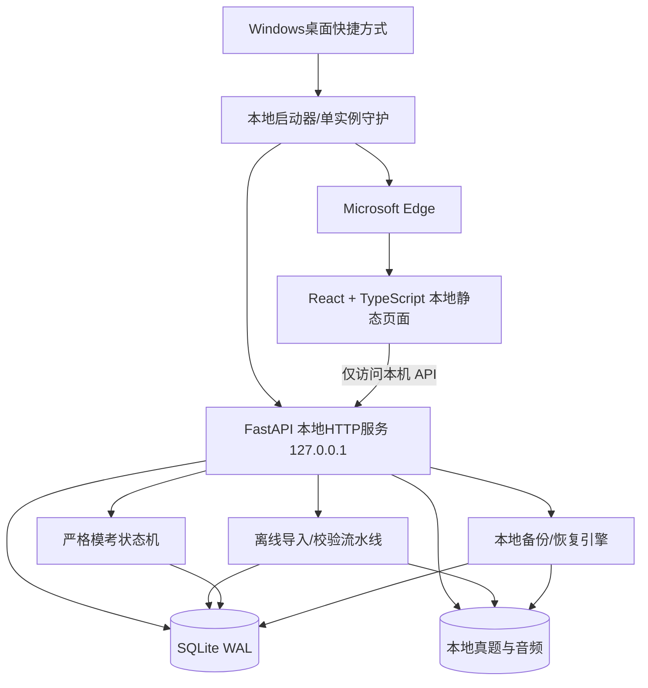

# CET-4 Study OS｜工程实施路线与GitHub仓库结构

> 确认来源：第49题B（核心优先分阶段交付）、第50题D（完整工程化交付）。本文件是实施计划，不代表已完成开发。

## 1. 架构总览



### 设计优先级

1. 本地独立与不依赖ChatGPT每日对话；
2. 真题源文件准确、可查验；
3. 模考可信，日常模式/模考模式彻底隔离；
4. 即时持久化、可恢复；
5. 升级/卸载不丢数据；
6. 界面体验与未来扩展。

## 2. 建议代码仓库

```text
cet4-study-os/
  README.md
  CHANGELOG.md
  LICENSE
  .gitignore
  docs/
    PRD.md
    REQUIREMENTS_MATRIX.md
    ARCHITECTURE.md
    IMPORT_FORMATS.md
    DATABASE.md
    INSTALL.md
    BACKUP_RESTORE.md
    UPGRADE_ROLLBACK.md
    QA_REPORT.md
  frontend/
    src/
      pages/
      components/
      api/
      state/
      tests/
    package.json
    package-lock.json
  backend/
    app/
      main.py
      api/
      models/
      services/
        import_pipeline/
        audio_segments/
        exam_state_machine/
        wrongbook/
        backups/
      migrations/
    tests/
    pyproject.toml
    requirements.lock
  launcher/
    windows_launcher.py
  installer/
    cet4.iss
  tests/
    e2e/
    fixtures/            # 只能放授权或自编样例，禁止用户原始真题
  scripts/
    build_windows.ps1
    verify_install.ps1
  .github/workflows/
    test.yml
    windows-build.yml
```

## 3. 分阶段开发（含阻断验收条件）

**M0：先确认高风险能力是否可行**  
在真实Windows11+Edge机器，使用至少一套用户自有的混合格式真题，验证PDF/Word/扫描OCR可靠性、标准答案对齐、完整MP3解析、分段候选质量。输出成功率、失败案例和处理边界。**没有通过该阶段，不承诺“系统可自动导入所有真题”。**

**M1：核心可用**  
Windows exe安装、桌面启动、Edge入口、本地SQLite；3入口导入＋来源校验；听力分题播放与人工切分确认；阅读3题型；自由训练与答案；自动保存与数据恢复；备份/恢复。达标后可投入日常使用。

**M2：错题复习**  
日常手动收藏、错题去重、每日混合抽题、即时答案反馈、跨日三连对判掌握；先不模拟自动错题来源，等待M3上线后接入。

**M3：模考与趋势**  
真实考试140分钟整体时序，完整音频连续播放与切题锁定；客观题判分、历史趋势；中断检测；模考错题自动入库；写作翻译线下作答/不评分。完整运行至少2套真实试卷做端到端回归。

**M4：故障、迁移和更新**  
端口冲突恢复、故障日志导出、数据库校验、安全恢复、升级前备份、回滚、卸载重装数据保护、磁盘满场景。

**M5：正式工程交付**  
独立GitHub私有仓库、依赖锁定、可运行CI、Windows构建、版本标签、安装包SHA256、用户手册、技术文档、QA报告与已知问题清单。正式交付前用户Windows目标机做真实试卷验收。

## 4. GitHub策略与质量门禁

- 项目仓库建议初始设为`private`，分支保护仅经过测试的代码可合并到`main`。
- 禁止上传原始用户真题、音频、个人学习记录、备份；使用`.gitignore`和提交前扫描。
- 测试失败、SQL迁移失败、构建不一致、许可检查未通过时禁止发布稳定安装包。
- 所有对数据库和模考时序的修改必须附回归测试和日志。
- CI在受支持的Windows Runner上构建，但CI通过**不替代**目标Windows11+Edge实体测试。
- 发行采用`v0.x`内测版本，稳定发布为`v1.0.0`，后续`v1.0.1`等补丁更新；每次发布生成SHA256和CHANGELOG。

## 5. 可执行开发任务（建议编号）

| 编号 | 实现任务 | 验收条件 |
|---|---|---|
| DEV-01 | Windows启动器、单实例服务和Edge打开 | 双击快捷方式稳定打开本地网页 |
| DEV-02 | SQLite、持久化、数据库迁移 | 刷新/重启不丢已保存学习记录 |
| DEV-03 | 原始文件管理和3类上传入口 | 支持混合格式文件标识、哈希、分类 |
| DEV-04 | 题目结构化解析与异常报告 | 缺题、乱码、混套、错号明确拦截 |
| DEV-05 | 重传增量更新、映射审核 | 历史记录不丢，未确认映射不更新 |
| DEV-06 | 音频检测、自动建议切分、确认 | 能通过实际音频样本测试，共用题组一致 |
| DEV-07 | 日常听力播放器、参考资料 | 分题播放、可见原文答案、不计分 |
| DEV-08 | 三种阅读题型交互 | 选词唯一性与匹配重复选择正确 |
| DEV-09 | 练习历史与恢复 | 作答和阅读位置实时可靠保存 |
| DEV-10 | 自动备份、手动备份/恢复/导出 | 故障注入与恢复完整通过 |
| DEV-11 | 错题收藏、混合抽题、三连掌握 | 每日规则、去重、历史记录正确 |
| DEV-12 | 完整140分钟模考状态机 | 严格流程、阶段锁定、不泄漏答案 |
| DEV-13 | 模考客观评分和趋势 | 55道题准确；中断不计成绩 |
| DEV-14 | 系统诊断和更新回滚 | 安全恢复、升级迁移测试通过 |
| DEV-15 | 安装包、GitHub CI及最终文档 | 在干净Windows11机器可复现安装和使用 |

## 6. 与原云端原型的关系

早期HTML原型可以用于**界面参考**，但不能视为已经实现以下能力：SQLite本地服务、真实扫描OCR、完整音频切分、140分钟严格模考、每日备份恢复、可执行Windows安装包、GitHub CI。

早期Next.js/Supabase/Vercel云端方案因用户第1、2、43、44题的决定已作废，不可作为本项目正式部署基线。

## 7. 合理交付边界

需求文件完成≠产品开发完成。可以以本资料包创建GitHub仓库并开始开发，但在实际代码、安装包、单元/端到端测试和实机验证完成前，不能宣称软件已正式落地或达到“低Bug率”。
